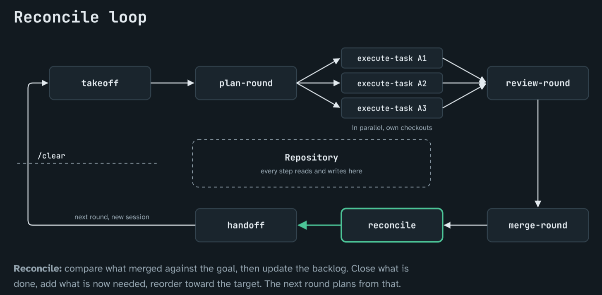

# Reconcile-loop

A workflow for running coding agents on a project in short rounds. In each round a planner agent picks
small tasks, separate agents implement them on their own branches, the PRs are reviewed and merged,
and the backlog is updated to match what was actually merged. The next round starts in a new session
that reads the repository, not earlier chats.



Agents forget between sessions and tend to report their own work as done. Here progress lives in files
in the repo, and a task only counts once it has been reviewed, merged and recorded in the backlog.

## What you need

- Git and Python 3.11+.
- A coding agent: Claude Code, Codex, or any agent that can follow a Markdown prompt.
- In your project: a document describing what you are building, a backlog of tasks (plain Markdown
  is fine) and a command that checks your work, such as your test suite.

## Quickstart

```sh
git clone https://github.com/TKontu/Reconcile-loop /tmp/reconcile-loop   # add --branch vX.Y.Z to pin a release
cd your-project
cp -r /tmp/reconcile-loop/{.agent,.agents,.claude,scripts,templates,examples,SPEC.md} .
```

If your project already has `.claude/` or `.agents/`, merge by hand instead of overwriting. Then open
your agent in the project and run bootstrap:

- Claude Code: `/bootstrap`
- Codex: `$bootstrap`
- Other agents: "Follow `.agent/commands/bootstrap.md`"

Bootstrap writes `.agent/config.toml` with your real paths and check command, adds the workflow rules
to your `AGENTS.md`, ignores `.agent-runs/` and gets one task ready. It does not start any work.

## Run a round

| Step | Who | What happens |
| --- | --- | --- |
| [takeoff](.agent/commands/takeoff.md) | Planner, new session | Reads the repo and reports where things stand |
| [plan-round](.agent/commands/plan-round.md) | Planner | Picks tasks and writes one assignment file per task |
| [execute-task](.agent/commands/execute-task.md) | One agent per task, own checkout | Implements, runs checks, opens a PR, returns a result file |
| [review-round](.agent/commands/review-round.md) | Planner and a reviewer | Checks each PR against its assignment |
| [merge-round](.agent/commands/merge-round.md) | Whoever may merge, usually you | Merges approved PRs |
| [reconcile](.agent/commands/reconcile.md) | Planner | Updates the backlog to match what merged and closes the round |
| [handoff](.agent/commands/handoff.md) | Planner | Writes a short note for the next session |

Start each step the same way as bootstrap (`/takeoff`, `$takeoff`, or point the agent at the file).
You carry files between agents: give each implementing agent its assignment from `.agent-runs/`, then
record the result it returns with `python3 scripts/round.py record`. The script only keeps the round
records consistent. It does not start agents, run tests or merge. The [worked example](examples/one-round.md)
shows a full round with commands.

Optional helpers: [status](.agent/commands/status.md) reports on the backlog without changing anything,
and [pr-verdict](.agent/commands/pr-verdict.md) gives an advisory review of one PR. Claude Code also
gets three subagents (review-lens, ci-watcher, quick-fixer). Their Codex skills read the same files
under `.claude/agents/`, so copy that folder for Codex too.

## Reference

- [SPEC.md](SPEC.md): the full rules.
- [.agent/commands/](.agent/commands/bootstrap.md): instructions for each step.
- [templates/](templates/assignment.md): assignment, result, task and handoff templates.
- `python3 scripts/round.py --help`: the round script.

## Contributing

Run `python3 -m unittest discover -s tests` and `git diff --check`. The tests need no network or extra
packages. Only `main` is maintained; an older, larger version is kept on the
[docs/standalone-patterns](https://github.com/TKontu/Reconcile-loop/tree/docs/standalone-patterns) branch.

MIT licensed ([LICENSE](LICENSE)). Keep the notice when you copy the files.
